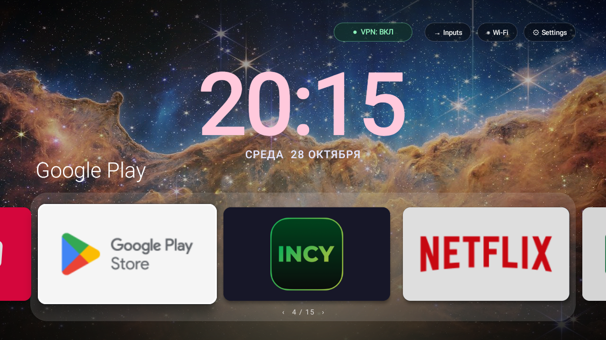
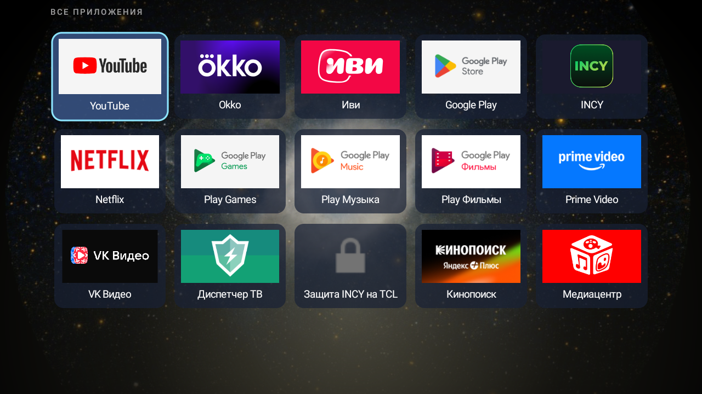
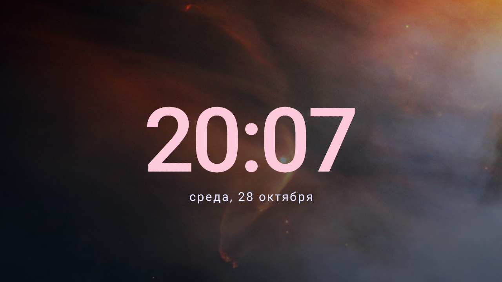

# TCL Space Home

Моя доработка домашнего экрана Android TV: космические обои, крупные часы, бесконечная карусель и быстрая сетка приложений. Основа — [tv-home Михаира Гупты](https://github.com/mihirgupta0900/tv-home), MIT. Автор доработки: [Heavenfiend](https://github.com/Heavenfiend).



## Возможности

- YouTube, OKKO и Иви первыми; остальные TV-приложения добавляются автоматически.
- Вниз с карусели — сетка приложений; вверх из первого ряда — назад. OK запускает приложение.
- Большие часы по центру, шесть космических фонов без интернета.
- Системная заставка с часами: фон меняется через 90 секунд, на главной — через 10 минут.
- Слева от Inputs — статус системного VPN. Зелёный: подключён, красный: отключён, серый: состояние недоступно. Не привязан к INCY, не проверяет доступность сайтов и маршрутизацию каждого приложения. Android может скрывать VPN от исключённых из него приложений.
- Отдельный необязательный помощник защиты INCY от очистки фоновых приложений TCL.

## Установить на другой телевизор

Проверено на TCL UnionTV, Android 9 (API 28). Другие Android TV и Google TV отдельно не проверялись. На Samsung Tizen, LG webOS и VIDAA эти APK не работают. VPN-клиент и подписка в проект не входят.

1. Скачай [TvHomeSpace.apk](apk/TvHomeSpace.apk) (на странице файла нажми Download raw file). Для TCL при необходимости также [TclVpnGuard.apk](apk/TclVpnGuard.apk).
2. Установи APK через файловый менеджер с разрешением установки из неизвестных источников либо используй ADB ниже.
3. Открой домашний экран и проверь управление, приложения и настройки. Затем выбери его домашним экраном по умолчанию в настройках Android TV, если прошивка позволяет.
4. В настройках заставки выбери «Космические часы». Для ADB есть команда ниже.
5. INCY установи и настрой отдельно. Помощник запускается только после его открытия и включения защиты. Он защищает именно INCY, не другие VPN. На новой прошивке сначала проверь, нужен ли он вообще.

Не удаляй и не отключай штатный лаунчер до проверки. Никакие списки отключения системных пакетов из этого проекта автоматически не применяются.

### Через ADB

Телевизор и компьютер должны находиться в одной сети; включи отладку и разреши подключение компьютера на телевизоре. Подставь актуальный адрес вместо TV_IP. Команды выполняются из корня скачанного репозитория.

```sh
adb connect TV_IP:5555
adb -s TV_IP:5555 install -r apk/TvHomeSpace.apk
adb -s TV_IP:5555 shell am start -n local.tcl.tvhome/com.mihir.tvhome.MainActivity
```

После визуальной проверки, если прошивка разрешает:

```sh
adb -s TV_IP:5555 shell cmd package set-home-activity local.tcl.tvhome/com.mihir.tvhome.MainActivity
```

Для заставки сначала запиши прежние значения `settings get secure screensaver_components` и `settings get secure screensaver_enabled`, затем:

```sh
adb -s TV_IP:5555 shell settings put secure screensaver_components local.tcl.tvhome/com.mihir.tvhome.SpaceDreamService
adb -s TV_IP:5555 shell settings put secure screensaver_enabled 1
```

Необязательная защита INCY:

```sh
adb -s TV_IP:5555 install -r apk/TclVpnGuard.apk
adb -s TV_IP:5555 shell am start -n local.tcl.vpnguard/.MainActivity
```

### Вернуть штатный экран

Сначала выбери прежний домашний экран в настройках или назначь записанный ранее компонент через `cmd package set-home-activity`. Верни прежние настройки заставки. Отключи защиту в её приложении. После проверки штатного экрана при желании удали `local.tcl.tvhome` и `local.tcl.vpnguard`. Названия штатных лаунчеров зависят от модели: универсальной команды отключения здесь нет.

## Как устроено и как собрать

`launcher/src` — Java-доработки; `guard/src` — помощник INCY. `vendor/tvhome-base.apk` — сохранённая Android 9-совместимая сборка исходного tv-home. Сборка объединяет её DEX с новыми классами; это адаптер к конкретной версии основы, а не полностью независимый лаунчер. Оригинальные MainActivity и ресурсы сохраняются; compile-time stub в APK не входит.

Скрипты сборки рассчитаны на Windows, Python 3, JDK 17 (`JAVA_HOME`), Android SDK (`ANDROID_SDK_ROOT`), platform android-35 и Build Tools 36.0.0. Без указанных компонентов сборка завершится ошибкой. Исходники дополнений открыты; восстановление полной исходной Android 9-версии MainActivity не выполнено.

```sh
python guard/build.py
python launcher/build.py
```

Первый скрипт создаёт локальный ключ `keys/local.jks`, второй использует тот же ключ. APK появятся в `apk/`. Это новый ключ: такими сборками нельзя обновить опубликованные APK поверх без исходного ключа. `TVHOME_KEYSTORE` позволяет указать свой ключ (ожидаются alias guard и пароль android). Сделай личную резервную копию ключа; в Git он не включается. Опубликованные APK подписаны прежним локальным ключом и совпадают с установленными на проверенном TCL.

## Проверка

Текущий лаунчер: 1.4-vpn-status (versionCode 5). На TCL проверены навигация пультом, запуск Иви, возврат Home, заставка и смена её фона, VPN включён/отключён/снова включён. Подпись и ZIP alignment проверены. Проверки на других моделях и новых Android не выполнялись; ограничения фоновых процессов могут отличаться.




## Авторство и материалы

Основа tv-home: Copyright (c) 2026 Mihir Gupta, лицензия MIT сохранена в LICENSE. Доработки: Heavenfiend, 2026, MIT. Проект вдохновлён настройкой Android TV и [CleanYourTV](https://github.com/Gathin23/cleanyourtv), но не является его официальной сборкой. Логотипы приложений на снимках принадлежат их владельцам. Космические материалы и исходные ссылки перечислены в [credits](docs/space-wallpaper-credits.json); лицензия MIT к фотографиям автоматически не применяется.
